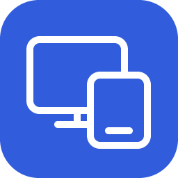

  

<h1 align="center">Рядом</h1>

<strong>Удалённая помощь близким. Где бы вы ни были.</strong>

Windows 10/11 · Rust + Flutter · GNU AGPL-3.0 · В разработке

<a href="#english-summary">English summary</a> · Русский

  <a href="#быстрый-старт">Начать</a> ·
  <a href="ROADMAP.md">Планы</a> ·
  <a href="CONTRIBUTING.md">Помочь проекту</a> ·
  <a href="https://github.com/chico1969/ryadom/issues">Сообщить об ошибке</a> ·
  <a href="ryadom/README_RU.md">Сборка и документация</a>

«Рядом» — открытое приложение для помощи родителям, родственникам и знакомым.
Цель: запустить программу, передать короткий ID и разрешить подключение.
Программа может как принимать подключения, так и управлять другим ПК.

**Сейчас это тестируемый форк, а не стабильный публичный выпуск.** Семейные
сборки проходят проверку; публичные CI-сборки и цифровая подпись готовятся.
Не используйте тестовую версию как единственный способ доступа к важному ПК.

## Что разрабатываем

| Для человека за удалённым ПК | Для того, кто помогает |
| --- | --- |
| Короткий ID и подтверждение доступа | История подключений и понятная панель управления |
| Portable для разовой помощи | Экран, мышь, клавиатура и несколько мониторов |
| Setup со службой для постоянного доступа | Файлы, буфер обмена, чат и звук |
| Видимый маршрут P2P или TURN | Восстановление связи после сетевого обрыва |

Наличие функции в коде не означает завершённую проверку всех условий.
Текущее состояние и оставшиеся испытания: [документация](ryadom/README_RU.md),
[проверка на двух ПК](ryadom/TEST_ON_TWO_PCS_RU.md), [планы](ROADMAP.md).

## Быстрый старт

1. Используйте только опубликованный в этом репозитории выпуск, когда он будет
   доступен в [Releases](https://github.com/chico1969/ryadom/releases).
   Публичного проверенного подписанного выпуска пока нет.
2. Для разовой помощи запустите Portable на обоих ПК. Владелец удалённого ПК
   сообщает ID и подтверждает доступ. Постоянный пароль настраивается отдельно.
3. Для работы после перезапуска Windows установите Setup с разрешения владельца.
   Установка службы требует прав администратора; Portable может помогать без них
   в пределах разрешений текущего пользователя.

Программа не обходит запросы администратора и не гарантирует доступ через любую
корпоративную или мобильную сеть. Доступ до запуска Windows не предусмотрен.

## Как соединяются компьютеры

Служба поиска передаёт сведения для согласования соединения. Сеанс сначала
пытается использовать прямой WebRTC P2P; TURN служит резервом, если настроен.
В интерфейсе отображается фактически выбранный маршрут.

**Общего бесплатного неограниченного TURN для публичной версии нет.** Личные
семейные учётные данные не входят в публичные исходники и CI-сборки. Владельцу
нужен собственный резерв либо будущая выдача временных данных с квотами.
Подробности и варианты: [TURN для публичной версии](ryadom/TURN_PUBLIC_RU.md).

## Разработчикам и испытателям

Нужны воспроизводимые отчёты с Windows 10/11, разными DPI, мониторами и сетями,
а также помощь с доступностью, безопасностью и сборкой. Начните с
[CONTRIBUTING.md](CONTRIBUTING.md). Сборка Windows и браузерного движка описана
в [ryadom/README_RU.md](ryadom/README_RU.md).

Используются закреплённые исходники RustDesk 1.5.3; совместимость с обычными
клиентами RustDesk не заявляется. Поддержка macOS/Linux/мобильных платформ
в исходном ядре не означает, что готов соответствующий выпуск «Рядом».

## Code signing policy

Текущие development EXE не подписаны. Подготовка SignPath не означает одобрение
или спонсорство. [Правила подписи](CODE_SIGNING.md) · [Конфиденциальность](PRIVACY.md)
· [Сообщить об уязвимости](SECURITY.md).

## Происхождение и лицензия

Независимый форк [RustDesk](https://github.com/rustdesk/rustdesk), базовый коммит
`95cca3f661f635b3cc85c04935fe8d96d8f432ef`. Благодарим авторов RustDesk и открытых
зависимостей. Уведомления сохранены; [исходный README](https://github.com/rustdesk/rustdesk/blob/95cca3f661f635b3cc85c04935fe8d96d8f432ef/README.md).

Код «Рядом» распространяется под [GNU AGPL version 3](LICENCE).
Это независимый проект, не официальный выпуск RustDesk.

## English summary

Ryadom is an independent AGPL-3.0 fork of RustDesk 1.5.3 for Windows remote
assistance to family and known users. It focuses on a simple Russian interface,
portable and installed modes, short device IDs, consent-based access, WebRTC
P2P and an optional user-configured TURN fallback.

Development sources are public; a stable signed public binary release is not
available yet. The public build contains no family TURN credentials and does
not provide unlimited free relay service. Testing and contributions are welcome.
See [contributing](CONTRIBUTING.md), [privacy](PRIVACY.md),
[security](SECURITY.md), [code signing](CODE_SIGNING.md) and [roadmap](ROADMAP.md).
